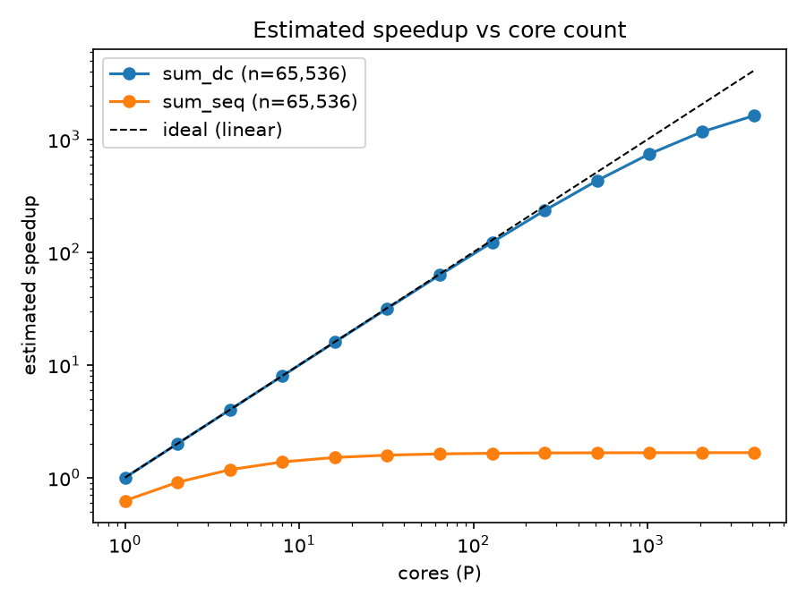
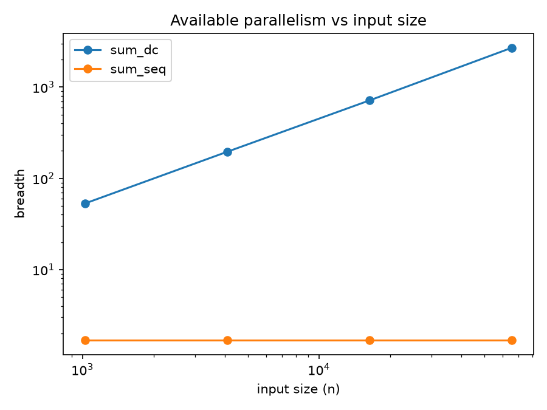

# vine-parallelism

A small experiment on how much parallelism Vine can find depending on how a program is written.<br>
The same sum written two ways, a plain loop and a divide-and-conquer recursion, ran both with vine run --breadth-first, and Brent's bound used to estimate how they'd do on a machine with P cores instead of infinitely many.

Headline: at n = 65,536, the divide-and-conquer sum has a breadth of ~2,700 and an estimated speedup of ~740× on 1,024 cores. The sequential loop's breadth stays at ~1.67 at every input size, so it can never usefully use more than about two cores.

## Results

| n | sum_seq: total | sum_seq: depth | sum_seq: breadth | sum_dc: total | sum_dc: depth | sum_dc: breadth |
| ---: | ---: | ---: | ---: | ---: | ---: | ---: |
| 1,024 | 16,282 | 9,814 | 1.66 | 40,824 | 770 | 53 |
| 4,096 | 62,393 | 37,482 | 1.66 | 160,663 | 822 | 195 |
| 16,384 | 246,767 | 148,115 | 1.67 | 639,949 | 895 | 715 |
| 65,536 | 984,078 | 590,503 | 1.67 | 2,556,908 | 947 | 2,700 |

<br>





## Method

- Programs: both sum f(i) = (i² + 7) mod 1000 over [0, n). `sum_seq` uses a loop; `sum_dc` recursively halves the range and adds the two halves.
- Measurement: `vine run --breadth-first` executes every active pair at each step, as if on an infinitely parallel machine, and reports total interactions and depth.
- Cost model: estimated time on P cores uses Brent's upper bound, T_P ≈ W/P + D, assuming one time unit per interaction. Estimated speedup is W / T_P.


## What I found

The loop's depth grows linearly with n, at roughly 9 interactions per element. The recursive version's depth only goes up by about 30 each time n doubles, and its breadth grows by about 3.7× every time n quadruples, which is roughly what you'd expect from n / log n.

For the sequential loop, each element costs about 15 interactions, and only about 9 of them are on the critical path (the add, the counter, the comparison). Computing `f(i)` only depends on `i`, so Vine runs it alongside the chain instead of inside it.

The recursion isn't free. It does about 2.6× as many interactions as the loop (~39 per element against ~15). So compared with the loop on a single core, the recursive version only breaks even at around 3 cores. The estimate at 1,024 cores is more like 290× (against the sequential loop) than 740×.

Speedup stays close to linear until the core count gets near the breadth.

## Caveats

- The cost model counts every interaction as one time unit and ignores moving data between cores, memory limits, and how work gets assigned to cores. In a real chip those are probably the hard part, and I haven't modelled them.
- Brent's bound is an upper bound on time, so at P = 1 it gives W + D instead of W. That's why the loop appears to run slower than 1× on one core in the plot.
- This is one very regular workload with a cheap `f`.

## Reproduce

Requirements: <br>
Python Version 3.13 <br>
[Vine](https://github.com/VineLang/vine)

```bash
pip install -r requirements.txt
python run_experiments.py   # runs both programs at each size, writes results.csv
python analyse.py           # writes speedup.png and breadth.png
```

